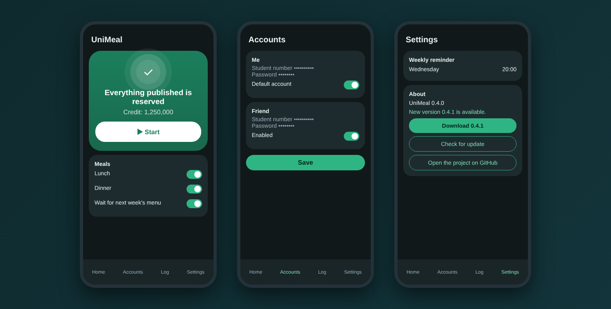

# UniMeal for Android

**Never miss a meal reservation: UniMeal reserves your lunch and dinner on SAMAD for you.**

[**Download the latest APK**](https://github.com/Mrzzan05/UniMeal-Android/releases/latest) · [فارسی](README_FA.md) · [Changelog](CHANGELOG.md) · [Security](SECURITY.md)

---

You press **Start**. UniMeal signs in to SAMAD (University of Urmia), reads the week, reserves the missing lunches and dinners at the *Veterinary Taak* self, moves on to the next week and repeats until everything that is published is reserved, or until you press **Stop**. If food is sold out or credit is too low it only tells you. It never picks another self and never cancels anything.

## Features

| | |
|---|---|
| **Safe first run** | *Preview only* is on by default: the first run just lists what it would reserve, with one button to reserve those now. |
| **Waits for the new menu** | Keeps checking (every 45 s – 3 min, your choice) until next week is published, reserves it, then stops. |
| **Weekly reminder** | Pick a day and time and get a "press Start" reminder, also after a reboot. |
| **Internet aware** | Offline, or on Wi-Fi that still needs a sign-in? It waits and continues the moment the connection is back. |
| **Several accounts** | Yours first, then friends who asked you. Saved only when you press Save. |
| **Open SAMAD** | Signs you in to the website inside the app with the default account. Notifications that need you to finish by hand have the same button. |
| **Spending limit** | Optional maximum to spend per run. |
| **Log tab** | Every step, never with passwords, so problems are easy to diagnose. |
| **Update check** | Settings → *Check for update* asks GitHub for the newest release and opens its page or APK. Only when you tap it. |
| **Look and feel** | Light and dark theme, English and Persian, swipe between tabs, and lively animations. |
| **Battery friendly** | One foreground service, at most 12 h per run, shortcut to allow background activity. |

## Install

1. Download `UniMeal-vX.Y.Z.apk` from the [latest release](https://github.com/Mrzzan05/UniMeal-Android/releases/latest).
2. Open it and allow installing from your browser or file manager when Android asks.
3. Open UniMeal → **Accounts** → add your student number and password → **Save**.
4. Go to **Home** and press **Start**. Turn *Preview only* off when you are happy with what it lists.

Updating: install the new APK over the old one; settings are kept. Verify it with `SHA256SUMS.txt` from the same release if you like.

## Privacy and security

- Student number and password are encrypted (AES-256-GCM, key in the Android Keystore) and stay on this phone. They are sent only to `nds.urmia.ac.ir` over HTTPS.
- Normal certificate validation. If the certificate is not trusted, the app stops and sends nothing.
- Redirects are followed only inside the same host. The in-app website view gets a session cookie, never your password.
- No server, analytics or ads. Backups are disabled.
- A wrong password stops the run at once (repeated failures cause captchas or lockouts).
- The update check contacts only `api.github.com` and sends no account data.

Details and how to report a problem: [SECURITY.md](SECURITY.md). Change your SAMAD password if you ever shared it anywhere.

## Build

`gradle :app:testDebugUnitTest :app:assembleDebug` (Gradle 8.9, JDK 17). The parser, form builder, planner and runner are plain Kotlin with unit tests against a saved SAMAD page.

### Publishing a signed release (maintainer)

1. Once: `powershell -ExecutionPolicy Bypass -File tools\setup-signing.ps1` creates a private key and stores it in the repository's secrets. **Back up the key file and password**; without them updates cannot install over the old app.
2. Bump `versionCode`/`versionName`, add a section to `CHANGELOG.md`, commit.
3. `git tag v0.4.0` then `git push origin v0.4.0`. GitHub Actions runs the tests, builds the shrunk release APK, signs it and publishes the release with the changelog text and a SHA-256.

Without the secrets, normal pushes still build a debug APK (an Actions artifact), but a tag does not publish anything.

Unofficial; not affiliated with the university. Use at your own risk.
